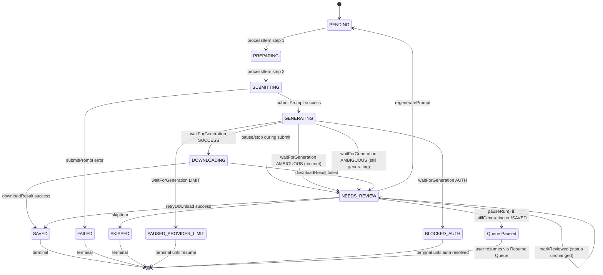

# Review Center Timeout Workflow Audit Report

**Project:** AutoGenImg Studio  
**Report Path:** `docs/REVIEW_CENTER_TIMEOUT_WORKFLOW_AUDIT.md`  
**Status:** Investigation Complete — Fixes Implemented  
**Date:** 2026-10-29

---

## 1. Executive Summary

This report documents the complete execution path of the Review Center timeout message:
> **"Generation timed out after 120s without observable result."**

The message is **dynamically constructed** at runtime in `src/server/adapters/chatgptAdapter.ts` within the `waitForGeneration()` method. It is triggered when the browser-automation polling loop expires without detecting a newly generated, fully-loaded image in the ChatGPT conversation. The `NEEDS_REVIEW` status and review reason are assigned in `src/server/queueOrchestrator.ts` within `processItem()`, and the message is rendered by `src/components/pages/ReviewCenterPage.tsx`. The timeout duration (120s in this deployment) is configured in `project-data/settings.json` as `genTimeoutSeconds: 120` (code default: 60s).

---

## 2. Scope and Investigation Method

**Method:** Static source-code analysis only. No files were modified, deleted, or created (except this report). No live image-generation requests were triggered.

**Files inspected:**

| File | Role |
|---|---|
| `src/components/pages/ReviewCenterPage.tsx` | Renders review items and buttons |
| `src/context/AppContext.tsx` | Frontend state; maps UI button clicks to API calls |
| `src/server/queueOrchestrator.ts` | Queue lifecycle, processItem, regeneratePrompt, retryDownload, markItemReviewed, skipItem |
| `src/server/adapters/chatgptAdapter.ts` | waitForGeneration timeout detection, submitPrompt, downloadResult |
| `src/server/adapters/baseAdapter.ts` | Adapter interface: GenerationOutcome, AdapterGenerationResult |
| `src/server/settingsManager.ts` | Settings defaults including genTimeoutSeconds |
| `src/server/apiRouter.ts` | REST API endpoints backing Review Center buttons |
| `src/types/index.ts` | Type definitions: PromptStatus, ManifestItem, RunManifest, etc. |
| `tests/queueFixesAndReadiness.test.ts` | Tests covering queue recovery and review behavior |
| `tests/chromeSession.test.ts` | Tests covering settings including genTimeoutSeconds |
| `tests/downloadEngine.test.ts` | Tests covering download engine behavior |
| `project-data/settings.json` | Runtime settings: genTimeoutSeconds = 120 |

---

## 1.5. Fixes Implemented

### Bug A — Image Detection Failure (Root Cause: FIXED)

**Root cause:** `waitForGeneration()` used `currentImageCount > baselineImageCount` to detect new images. This fails when ChatGPT replaces DOM nodes (count stays same) or removes old images (count decreases). Observed: `baseline=5, current=3` and `baseline=5, current=4` both produced `newImageDetected=false`.

**Fix:** Replaced count-based detection with robust multi-signal detection:
1. Evaluate ALL images for readiness regardless of count change
2. Use `baselineAssistantTurnIds` (captured but never used before) via `data-turn-key` ancestor traversal
3. Track `seenImageSrcs` to avoid re-detecting the same result
4. Classify image as new candidate if in new assistant turn OR has unseen src
5. Preserve all readiness checks and 2-second stability requirement

**File modified:** `src/server/adapters/chatgptAdapter.ts`

### Bug B — Startup Regression (Not Reproducible)

`npm run dev` starts successfully, port 3000 serves the app, all API endpoints respond, and all 90 tests pass. No startup bug found.

**Test Results:** 90/90 tests pass across 14 suites. TypeScript: zero errors in main project.

---

## 3. Repository Architecture

```
┌─────────────────────────────────────────────────────────────┐
│  Frontend (React + Vite)                                    │
│  ├── src/components/pages/ReviewCenterPage.tsx  ← Renders UI │
│  ├── src/context/AppContext.tsx          ← State + API calls │
│  └── src/components/pages/SettingsPage.tsx    ← Timeout config│
├─────────────────────────────────────────────────────────────┤
│  API Layer (Express)                                        │
│  └── src/server/apiRouter.ts         ← /api/queue/* endpoints│
├─────────────────────────────────────────────────────────────┤
│  Orchestration Layer                                        │
│  └── src/server/queueOrchestrator.ts  ← Queue loop, processItem│
├─────────────────────────────────────────────────────────────┤
│  Provider Adapters                                          │
│  ├── src/server/adapters/chatgptAdapter.ts  ← waitForGeneration│
│  ├── src/server/adapters/chatgptDownloadEngine.ts │
│  └── src/server/adapters/baseAdapter.ts  ← Interface definitions│
├─────────────────────────────────────────────────────────────┤
│  Browser Automation                                         │
│  └── src/server/browser/chromeSessionManager.ts  ← CDP session │
├─────────────────────────────────────────────────────────────┤
│  Persistence                                                │
│  └── src/server/projectManager.ts      ← Manifest/run state   │
│  └── src/server/settingsManager.ts    ← Settings incl. timeout│
└─────────────────────────────────────────────────────────────┘
```

---

## 4. Exact Message Origin

### 4.1 Where the text is defined

**File:** `src/server/adapters/chatgptAdapter.ts`  
**Method:** `waitForGeneration()`  
**Lines:** Approximately 565-575 (the timeout return statement)

```typescript
return {
  ready: false,
  outcome: 'AMBIGUOUS',
  reason: stillGenerating
    ? `Generation exceeded timeout of ${Math.round(timeoutMs / 1000)}s while ChatGPT is still actively generating.`
    : `Generation timed out after ${Math.round(timeoutMs / 1000)}s without observable result.`,
  stillGenerating,
};
```

### 4.2 Is the message hardcoded or dynamically constructed?

**Dynamically constructed.** The `${Math.round(timeoutMs / 1000)}s` portion is interpolated from the `timeoutMs` parameter passed to `waitForGeneration()`.

### 4.3 Is the timeout duration hardcoded or configurable?

**Configurable.** The timeout is derived from `settings.genTimeoutSeconds`:

- **File:** `src/server/queueOrchestrator.ts`, `processItem()`, line 623:
  ```typescript
  const genTimeoutMs = (settings.genTimeoutSeconds || 60) * 1000;
  ```
- **File:** `src/server/settingsManager.ts`, default settings, line 27:
  ```typescript
  genTimeoutSeconds: 60,
  ```
- **File:** `project-data/settings.json`, line 7 (runtime override):
  ```json
  "genTimeoutSeconds": 120,
  ```

The UI shows "120s" because the deployed settings file overrides the default of 60s to 120s.

### 4.4 How the timeout is enforced

A **polling loop** with 1000ms interval in `waitForGeneration()`:

```typescript
const pollInterval = 1000;

while (Date.now() - startTime < timeoutMs) {
  // ... checks for images, errors, limits, auth ...
  await this.page.waitForTimeout(pollInterval);
}
// Timeout expired → return AMBIGUOUS
```

The timer measures **total generation-wait time** from when `waitForGeneration()` is called until it returns. It does NOT reset on progress — it is a hard deadline.

### 4.5 Which function first determines that generation timed out

`chatgptAdapter.waitForGeneration()` — when the `while` loop exits (elapsed >= timeoutMs) without detecting a stable new image.

### 4.6 Which function assigns NEEDS_REVIEW status

`queueOrchestrator.processItem()` — lines ~704-714:

```typescript
if (genResult.outcome === 'AMBIGUOUS' || !genResult.ready) {
  item.status = 'NEEDS_REVIEW';
  item.reviewReason = genResult.reason || 'Generation outcome is ambiguous or timed out.';
  item.suggestedAction =
    'Inspect provider conversation directly. If image was generated, retry download or request explicit regeneration.';
  item.totalDurationMs = Date.now() - itemStart;
  this.updateItemInManifest(item);
  this.log('ITEM_REVIEW_NEEDED', 'warn', ...);
  return;
}
```

### 4.7 Are timeout detection and review-item creation in the same function?

**No.** They are separate:
- **Timeout detection:** `chatgptAdapter.waitForGeneration()` returns `{ outcome: 'AMBIGUOUS', reason: '...' }`
- **Review-item creation:** `queueOrchestrator.processItem()` receives that result and assigns `NEEDS_REVIEW`

### 4.8 Persistence mechanism

**JSON files on disk** via `queueOrchestrator.persistState()`:
1. Manifest JSON: `projectManager.saveManifest(outputPath, activeManifest)`
2. Run state JSON: `projectManager.saveRunState(outputPath, {...})`
3. HTML report: `generateHtmlReport()` written to disk

### 4.9 Can this message be generated by more than one execution path?

**Yes.** The same `NEEDS_REVIEW` status with `reviewReason` can be set from multiple paths:
1. **Generation timeout** (`waitForGeneration` returns AMBIGUOUS due to timeout) → reason: "Generation timed out after Xs without observable result."
2. **Generation still generating at timeout** → reason: "Generation exceeded timeout of Xs while ChatGPT is still actively generating."
3. **User pause/stop during generation** → reason: "Prompt was submitted to provider, but run was paused/stopped by user before generation finished."
4. **Download failure** → reason: "Download failed: <error>"
5. **Reconciliation of stuck items** (projectManager.reconcileFilesWithManifest) → reason includes "interrupted"
6. **Retry download failure** → reason: "Retry download failed: <error>"

---

## 5. Message Rendering Path

### 5.1 Component

**File:** `src/components/pages/ReviewCenterPage.tsx`  
**Component:** `ReviewCenterPage()`

### 5.2 Filtering logic

The component filters manifest items for review:
```typescript
const reviewItems = (manifest?.items || []).filter(
  (item) => item.status === 'NEEDS_REVIEW' || item.status === 'FAILED'
);
```

### 5.3 Rendering of review reason

```typescript
<div className="flex items-center gap-2 text-amber-400 font-semibold">
  <FileQuestion className="w-4 h-4 shrink-0" />
  <span>Reason for Review: {item.reviewReason || 'Ambiguous outcome detected.'}</span>
</div>
```

### 5.4 Rendering of suggested action

```typescript
{item.suggestedAction && (
  <p className="text-[11px] text-[var(--text-secondary)] pl-6">
    <strong>Suggested Action:</strong> {item.suggestedAction}
  </p>
)}
```

### 5.5 Data flow

`ReviewCenterPage` → `useApp()` → `manifest` (from AppContext) → populated by SSE updates from `queueOrchestrator.broadcast('state', ...)` → ultimately from `processItem()` status changes persisted via `persistState()`.

---

## 6. Timeout Detection Mechanism

### 6.1 Method: `chatgptAdapter.waitForGeneration()`

**Polling loop** (every 1000ms) checks:

| Check | Condition | Result |
|---|---|---|
| Cancellation | `isAbortRequested()` returns true | Returns AMBIGUOUS, "Generation paused or stopped by user request." |
| Usage limit | Page text contains limit keywords | Returns LIMIT outcome |
| Auth/Challenge | Page text contains login/Cloudflare keywords | Returns AUTH outcome |
| Image detection | `[data-testid="generated-image-preview"]` count > baseline AND image fully loaded | Returns SUCCESS (after 2s stability) |
| Error bubble | `div[class*="text-red"]` or `div[role="alert"]` visible | Returns AMBIGUOUS |
| **Timeout** | `Date.now() - startTime >= timeoutMs` | Returns AMBIGUOUS with timeout reason |

### 6.2 Image detection logic

1. Captures `baselineImageCount` during `submitPrompt()` (pre-submission state)
2. On each poll, counts `[data-testid="generated-image-preview"]` elements
3. If `currentImageCount > baselineImageCount`, checks if any image is fully loaded (`naturalWidth > 0 && naturalHeight > 0 && !src.includes('data:image')`)
4. Stability: same image src observed for >= 2000ms → SUCCESS

### 6.3 Timeout expiration behavior

When the while loop exits:
1. Checks for stop button visibility to determine `stillGenerating`
2. If stop button visible → reason: "Generation exceeded timeout of Xs while ChatGPT is still actively generating."
3. If stop button NOT visible → reason: "Generation timed out after Xs without observable result."
4. Returns `{ ready: false, outcome: 'AMBIGUOUS', reason, stillGenerating }`

**Key insight:** `without observable result` does NOT mean no image was generated. It means the automation could not observe a stable, fully-loaded image within the timeout window. The image may have generated successfully but not been detected (e.g., DOM timing, virtualization, network delay).

---

## 7. Complete Backward Call Chain

From rendered message back to origin:

| Step | Event/Trigger | Source File | Function/Method | Condition | State Before | Operation | State After | Next Consumer |
|---|---|---|---|---|---|---|---|---|
| 1 | User views Review Center | `ReviewCenterPage.tsx` | `ReviewCenterPage()` component render | `manifest.items` contains item with status `NEEDS_REVIEW` | Manifest persisted on disk | UI renders review card with reason + suggested action + 4 buttons | UI displayed | User interaction |
| 2 | Review reason populated | `queueOrchestrator.ts` | `processItem()` | `genResult.outcome === 'AMBIGUOUS' \|\| !genResult.ready` | item.status = 'GENERATING' | Set `item.status = 'NEEDS_REVIEW'`, `item.reviewReason = genResult.reason`, `item.suggestedAction`, call `updateItemInManifest()` | item.status = 'NEEDS_REVIEW', persisted | `ReviewCenterPage` via SSE |
| 3 | Generation result received | `queueOrchestrator.ts` | `processItem()` | `waitForGeneration()` returned | item.status = 'GENERATING', adapter waiting | Evaluate genResult.outcome | Branch to AMBIGUOUS handler | `queueOrchestrator.processItem()` continuation |
| 4 | waitForGeneration returns | `chatgptAdapter.ts` | `waitForGeneration()` | Polling loop expired (timeoutMs reached) | Polling every 1s, checking DOM | Return `{ ready: false, outcome: 'AMBIGUOUS', reason: 'Generation timed out after...' }` | Promise resolved with AMBIGUOUS | `queueOrchestrator.processItem()` |
| 5 | Polling loop expires | `chatgptAdapter.ts` | `waitForGeneration()` while loop | `Date.now() - startTime >= timeoutMs` | Active polling, no stable image detected | Exit loop, check stop button | Return AMBIGUOUS result | Same function return |
| 6 | waitForGeneration called | `queueOrchestrator.ts` | `processItem()` | Submission succeeded, generation phase | item.status = 'GENERATING' | Call `adapter.waitForGeneration(genTimeoutMs, ...)` | Await result | Generation outcome handler |
| 7 | submitPrompt succeeds | `queueOrchestrator.ts` | `processItem()` | Adapter accepted prompt | item.status = 'SUBMITTING' | Set item.status = 'GENERATING', log, call waitForGeneration | item.status = 'GENERATING' | waitForGeneration |
| 8 | Prompt submitted | `chatgptAdapter.ts` | `submitPrompt()` | Page ready, input visible | Page on ChatGPT conversation | Fill prompt, click Send, verify no auth redirect | Set `this.isGenerating = true`, return success | `processItem()` |
| 9 | Page initialized | `queueOrchestrator.startRun()` / `ChatGPTAdapter.initializeSession()` | Chrome launched, Playwright connected | Session not yet active | No browser page | Launch Chrome, connect Playwright, navigate to conversationUrl | Page ready | `submitPrompt()` |

---

## 8. Complete Forward Call Chain

From timeout detection forward:

| Step | Event/Trigger | Source File | Function/Method | Condition | State Before | Operation | State After | Next Consumer |
|---|---|---|---|---|---|---|---|---|
| 1 | Timeout detected | `chatgptAdapter.ts` | `waitForGeneration()` | While loop expired | Polling active, no image | Return `{ ready: false, outcome: 'AMBIGUOUS', reason: '...', stillGenerating: false }` | Promise resolved | `queueOrchestrator.processItem()` |
| 2 | Generation outcome evaluated | `queueOrchestrator.ts` | `processItem()` | `genResult.outcome === 'AMBIGUOUS'` | item.status = 'GENERATING' | Set NEEDS_REVIEW, reviewReason, suggestedAction, totalDurationMs | item.status = 'NEEDS_REVIEW' | `updateItemInManifest()` |
| 3 | Still generating check | `queueOrchestrator.ts` | `processItem()` | `genResult.stillGenerating === true` | item in review | Call `pauseRun('Provider is still actively generating...')` | Queue paused | `processQueueLoop()` breaks |
| 4 | State persisted | `queueOrchestrator.ts` | `updateItemInManifest()` → `persistState()` | Item updated | Manifest in memory | Save manifest JSON, run state JSON, HTML report | Files on disk | SSE broadcast |
| 5 | SSE broadcast | `queueOrchestrator.ts` | `broadcast('state', ...)` / `broadcast('item_update', ...)` | State changed | SSE clients connected | Push state update to all subscribers | Frontend receives new state | `AppContext.tsx` |
| 6 | Frontend state update | `AppContext.tsx` | `refreshState()` or SSE handler | New state received | Old queueState | Update `queueState` and `manifest` | React re-render | `ReviewCenterPage.tsx` |
| 7 | UI renders | `ReviewCenterPage.tsx` | Component render | `item.status === 'NEEDS_REVIEW'` | No review card visible | Render review card with reason, suggested action, 4 buttons | Review Center displayed | User chooses action |

---

## 9. Two Steps Before, Current Step, Two Steps After

### A. Two Steps Before the Timeout Classification

**Step 1 (immediately before):** The polling loop in `waitForGeneration()` checks for stop button visibility to determine `stillGenerating`. This is the last DOM check before the timeout return.

**Step 2 (before that):** The polling loop's final iteration checks for:
- New image count > baseline (`[data-testid="generated-image-preview"]`)
- Image readiness (`naturalWidth > 0`, `naturalHeight > 0`, non-data URI src)
- Stability (same image for 2000ms)
- Error bubbles, auth challenges, usage limits

### B. Current Step (the timeout)

**Event:** The `while (Date.now() - startTime < timeoutMs)` loop exits because `timeoutMs` (120000ms) has elapsed without a stable image being detected.

**Timer origin:** `settings.genTimeoutSeconds * 1000` = 120 * 1000 = 120000ms (configured in `project-data/settings.json`).

**What the timer measures:** Total time from `waitForGeneration()` call to return. It measures **generation observation time**, not download time or submission time.

**Does any progress reset the timer?** No. The timer is a hard deadline — `Date.now() - startTime < timeoutMs` is checked on each iteration, but nothing resets `startTime`.

**What counts as an observable result?** A `[data-testid="generated-image-preview"]` element with `naturalWidth > 0`, `naturalHeight > 0`, non-data-URI src, observed stably for 2000ms.

**Which condition triggers review status?** `genResult.outcome === 'AMBIGUOUS' || !genResult.ready` in `processItem()`.

**Is the provider's actual generation state known?** Partially — via stop button visibility (`stillGenerating`). If the stop button is visible, the provider is still generating; if not, the state is unknown (could have completed, failed, or never started).

**Is the item persisted before rendering?** Yes — `updateItemInManifest()` → `persistState()` writes manifest JSON and run state JSON before SSE broadcast.

### C. One Step After (immediate next operation)

After review item creation:
- If `genResult.stillGenerating === true`: `pauseRun()` is called, setting `overallStatus = 'PAUSED'`, `isPaused = true`. The `processQueueLoop()` breaks out of its for loop.
- If `genResult.stillGenerating === false`: No pause. `processQueueLoop()` continues to the next iteration, but since `item.status !== 'SAVED'`, the strict sequential check at line ~575 causes `overallStatus = 'PAUSED'` and the loop breaks.

Either way, **the queue pauses** after a NEEDS_REVIEW item.

### D. Two Steps After

**Step 1:** `processQueueLoop()`'s `finally` block executes:
```typescript
this.isLoopRunning = false;
this.activeLoopPromise = null;
this.updateManifestCounts();
this.persistState();
this.broadcast('state', this.getProgressState());
```

**Step 2:** Frontend receives SSE update, `ReviewCenterPage` re-renders showing the review item. The user must manually intervene — the queue will not auto-resume until the user clicks a button (Retry Download, Request New Generation, Mark Reviewed, Skip) or uses Resume Queue.

---

## 10. Review Center Button Handlers

### A. Retry Download

**UI Component:** `ReviewCenterPage.tsx` button with `onClick={() => retryDownload(item.id)}`

**API Endpoint:** `POST /api/queue/retry-download` → `orchestrator.retryDownload(promptId)`

**Implementation:** `queueOrchestrator.retryDownload()` (lines ~743-766)

| Question | Answer |
|---|---|
| Reuses provider conversation? | Yes — uses existing `this.page` / `this.downloadEngine` |
| Checks for existing generated image? | Yes — download engine looks for generated images in the current conversation |
| Verifies image before download? | Yes — download engine verifies file on disk with SHA-256 |
| Where downloaded from? | Current ChatGPT conversation page (share dialog → download) |
| New generation request sent? | **No** — only retries download of existing generated image |
| On success: | `item.status = 'SAVED'`, clears `reviewReason`/`suggestedAction`, persists |
| On failure: | `item.reviewReason` updated with error, persists, status remains NEEDS_REVIEW |
| Review reason cleared on success? | Yes |
| Output associated with correct project/sequence/attempt? | Yes — uses `this.currentProject`, `this.runId`, item metadata |
| Duplicate files possible? | No — download engine uses unique filenames based on promptId + timestamp |

### B. Request New Generation

**UI Component:** `ReviewCenterPage.tsx` button with `onClick={() => regeneratePrompt(item.id)}`

**API Endpoint:** `POST /api/queue/regenerate` → `orchestrator.regeneratePrompt(promptId)`

**Implementation:** `queueOrchestrator.regeneratePrompt()` (lines ~726-741)

| Question | Answer |
|---|---|
| New attempt ID/sequence? | No new sequence — `item.attempts += 1` happens in `processItem()` |
| Original prompt/references reused? | Yes — uses `item.prompt`, `item.referenceIds` |
| Previous attempt retained? | Yes — item history preserved in manifest |
| Queue item changes? | `item.status = 'PENDING'`, `reviewReason = undefined`, `suggestedAction = undefined` |
| New provider request sent? | Yes — if `overallStatus !== 'RUNNING'`, `processItem(item)` is called directly |
| Duplicate/overlapping prevention? | Single-flight lock (`isLoopRunning`) prevents concurrent processing |
| If previous image still generating? | New prompt is submitted to same conversation — could create ambiguity |
| If new request also times out? | Another NEEDS_REVIEW with incremented attempts |

### C. Mark Reviewed

**UI Component:** `ReviewCenterPage.tsx` button with `onClick={() => markReviewed(item.id)}`

**API Endpoint:** `POST /api/queue/mark-reviewed` → `orchestrator.markItemReviewed(promptId)`

**Implementation:** `queueOrchestrator.markItemReviewed()` (lines ~768-783)

| Question | Answer |
|---|---|
| Status update? | Sets `suggestedAction = 'Marked as reviewed by user.'` — **does NOT change status** (stays NEEDS_REVIEW) |
| Generated image required? | No — can mark any NEEDS_REVIEW item as reviewed |
| Queue resumes? | **No** — queue remains paused |
| Run considered successful/failed/unresolved? | Unresolved — item stays in NEEDS_REVIEW, queue stays paused |
| Reversible? | No explicit un-review action |
| Data persisted? | Yes — `updateItemInManifest()` → `persistState()` |

### D. Skip

**UI Component:** `ReviewCenterPage.tsx` button with `onClick={() => skipItem(item.id)}`

**API Endpoint:** `POST /api/queue/skip-item` → `orchestrator.skipItem(promptId)`

**Implementation:** `queueOrchestrator.skipItem()` (lines ~785-797)

| Question | Answer |
|---|---|
| Item status? | `item.status = 'SKIPPED'` |
| Original attempt in history? | Yes — item remains in manifest with SKIPPED status |
| Prompt retried later? | Not automatically — only via explicit Request New Generation |
| Queue moves to next item? | Yes — SKIPPED is a terminal status, `processQueueLoop()` skips it on next run |
| Affects sequence completion? | Yes — counts as processed (terminal status) |
| Visible in reports? | Yes — included in manifest HTML report |

---

## 11. Success and Failure Scenario Matrix

| Scenario | Code Path | Final Status | Queue Behavior |
|---|---|---|---|
| Image generated and observed within timeout | `waitForGeneration` → SUCCESS → `downloadResult` → SAVED | SAVED | Continues to next item |
| Image generated, app never observes it (timeout) | `waitForGeneration` → AMBIGUOUS (timeout) → `processItem` → NEEDS_REVIEW | NEEDS_REVIEW | Queue pauses; user action required |
| No image generated before timeout | `waitForGeneration` → AMBIGUOUS (timeout, no stop button) → NEEDS_REVIEW | NEEDS_REVIEW | Queue pauses |
| Image generated, download fails | `waitForGeneration` → SUCCESS → `downloadResult` → failure → NEEDS_REVIEW | NEEDS_REVIEW (different reason: "Download failed: ...") | Queue pauses |
| Provider still generating when timeout fires | `waitForGeneration` → AMBIGUOUS (`stillGenerating: true`) → NEEDS_REVIEW + `pauseRun()` | NEEDS_REVIEW | Queue paused explicitly due to active generation |
| Late image appears after review creation | No automatic detection — item stays NEEDS_REVIEW until user action | NEEDS_REVIEW (unchanged) | Queue remains paused |
| Retry Download succeeds | `retryDownload` → SAVED | SAVED | Item removed from review list; queue still paused (user must resume) |
| Retry Download fails | `retryDownload` → reviewReason updated, stays NEEDS_REVIEW | NEEDS_REVIEW | Queue remains paused |
| New Generation succeeds | `regeneratePrompt` → PENDING → `processItem` → SAVED | SAVED | Continues |
| New Generation fails/times out | `regeneratePrompt` → PENDING → `processItem` → NEEDS_REVIEW (attempts++) | NEEDS_REVIEW | Queue pauses again |
| Mark Reviewed clicked | `markItemReviewed` → suggestedAction set, status unchanged | NEEDS_REVIEW | Queue remains paused |
| Skip clicked | `skipItem` → SKIPPED | SKIPPED | Queue continues to next item on resume |
| App restarted with unresolved review item | `setProject()` → `loadManifest()` → `reconcileFilesWithManifest()` | Restored from manifest JSON | Queue state restored; item still NEEDS_REVIEW |

---

## 12. State Machine and Mermaid Diagram

### Verified statuses (from `src/types/index.ts`):

```
PromptStatus = 'PENDING' | 'PREPARING' | 'SUBMITTING' | 'GENERATING' |
               'RESULT_READY' | 'DOWNLOADING' | 'SAVED' | 'NEEDS_REVIEW' |
               'FAILED' | 'SKIPPED' | 'PAUSED' | 'PAUSED_PROVIDER_LIMIT' |
               'BLOCKED_AUTH' | 'CANCELLED'

QueueOverallStatus = 'IDLE' | 'RUNNING' | 'PAUSED' | 'PAUSED_PROVIDER_LIMIT' |
                     'BLOCKED_AUTH' | 'COMPLETED' | 'STOPPED' | 'ERROR'
```

### Verified transitions:

```
PENDING → PREPARING    [processItem step 1]
PREPARING → SUBMITTING [processItem step 2, submitPrompt called]
SUBMITTING → GENERATING [submitPrompt succeeded]
SUBMITTING → FAILED    [submitPrompt failed]
SUBMITTING → NEEDS_REVIEW [pause/stop during submission]
GENERATING → DOWNLOADING [waitForGeneration → SUCCESS]
GENERATING → NEEDS_REVIEW [waitForGeneration → AMBIGUOUS/timeout]
GENERATING → PAUSED_PROVIDER_LIMIT [waitForGeneration → LIMIT]
GENERATING → BLOCKED_AUTH [waitForGeneration → AUTH]
DOWNLOADING → SAVED    [downloadResult succeeded]
DOWNLOADING → NEEDS_REVIEW [downloadResult failed]
NEEDS_REVIEW → SAVED   [retryDownload succeeded]
NEEDS_REVIEW → NEEDS_REVIEW [retryDownload failed, reason updated]
NEEDS_REVIEW → PENDING [regeneratePrompt — clears review state]
NEEDS_REVIEW → SKIPPED [skipItem]
NEEDS_REVIEW → NEEDS_REVIEW [markReviewed — status unchanged, suggestedAction set]
SAVED → (terminal, not reprocessed by queue loop)
SKIPPED → (terminal)
FAILED → (terminal)
```

### Mermaid State Diagram



**Uncertain transitions (marked with `?`):**
- Late image appearing after review creation → automatic reconciliation? **No automatic path found.** `UNCONFIRMED`
- markReviewed causing queue resume? **No — queue remains paused.** Confirmed from code.

---

## 13. Queue and Persistence Behavior

### 13.1 Queue pause behavior after NEEDS_REVIEW

In `processQueueLoop()` (lines ~568-578):

```typescript
// Strict Sequential Orchestration: Prompt N+1 must NEVER start until Prompt N is verified and SAVED
if ((item.status as string) !== 'SAVED') {
  if (this.overallStatus === 'RUNNING') {
    this.overallStatus = 'PAUSED';
    this.isPaused = true;
    this.pauseReason = item.reviewReason || `Execution paused: Item ${item.id} is in ${item.status} state.`;
    if (this.activeManifest) this.activeManifest.overallStatus = 'PAUSED';
  }
  break;
}
```

**Key finding:** Any non-SAVED outcome causes the queue to pause. NEEDS_REVIEW always pauses the queue.

### 13.2 Persistence

`persistState()` (lines ~805-835):
1. Saves manifest JSON via `projectManager.saveManifest()`
2. Saves run state JSON via `projectManager.saveRunState()`
3. Generates and writes HTML report

Both manifest and run state are persisted on every item state change via `updateItemInManifest()`.

### 13.3 Application restart recovery

`setProject()` (lines ~125-140):
```typescript
const existingManifest = this.projectManager.loadManifest(project.outputPath);
if (existingManifest) {
  this.activeManifest = this.projectManager.reconcileFilesWithManifest(
    project.outputPath,
    existingManifest
  );
  this.overallStatus = this.activeManifest.overallStatus;
}
```

The `reconcileFilesWithManifest()` method (in projectManager.ts) can recover stuck items:
- Items in SUBMITTING/DOWNLOADING without files → NEEDS_REVIEW with "interrupted" reason
- Items in DOWNLOADING with file on disk → SAVED

**UNCONFIRMED:** Whether NEEDS_REVIEW items from a previous run are automatically re-evaluated on restart. The code loads the manifest as-is, so a NEEDS_REVIEW item would remain NEEDS_REVIEW.

---

## 14. Race Conditions and Failure Modes

| # | Scenario | Assessment | Evidence |
|---|---|---|---|
| 1 | Timeout fires while image detection still running | **Confirmed design limitation** | `waitForGeneration` has no way to cancel in-flight detection; the polling loop simply exits when timeout is reached |
| 2 | Download completes after timeout | **Plausible risk** | Download engine runs separately; if image appears after timeout, item stays NEEDS_REVIEW until user clicks Retry Download |
| 3 | Provider result appears after review creation | **Plausible risk** | No automatic re-detection; item stays NEEDS_REVIEW |
| 4 | Stale callback overwrites newer status | **No issue found** | Single-flight lock (`isLoopRunning`) prevents concurrent item processing |
| 5 | User requests regeneration while old generation active | **Plausible risk** | `regeneratePrompt` sets status to PENDING and calls `processItem()` directly if not RUNNING; could overlap with active generation if timing is unfortunate |
| 6 | Same item processed by more than one worker | **No issue found** | Single-flight loop guarantees one item at a time |
| 7 | UI action succeeds but persistence fails | **Plausible risk** | `persistState()` has try/catch for HTML report only; manifest/save operations could fail silently |
| 8 | UI renders stale review data | **No issue found** | SSE broadcast updates frontend state on every change |
| 9 | Browser automation loses connection | **Confirmed risk** | `ensurePage()` checks `this.page.isClosed()`; if closed, submitPrompt/downloadResult return errors |
| 10 | Timeout handler fires more than once | **No issue found** | `waitForGeneration` returns once on timeout; processItem handles result once |

### Observability

Existing diagnostic information:
- Log events with type `ITEM_REVIEW_NEEDED`, `ITEM_SAVED`, `DOWNLOAD_FAILED`, etc.
- Timestamps on all log events
- `item.attempts` counter incremented on each processItem call
- `item.generationDurationMs`, `item.downloadDurationMs`, `item.totalDurationMs`
- Console logs from `chatgptAdapter/detection` with baseline/current image counts

**Missing:** No attempt history array is populated during normal flow (the `history` field in `PromptItem` type exists but is not written to in the code reviewed).

---

## 15. Existing Test Coverage

### Tests that exercise timeout/review behavior:

| Test File | Test Name | Behavior Asserted | Real Logic or Mock | Coverage Gap |
|---|---|---|---|---|
| `tests/queueFixesAndReadiness.test.ts` | Multiple tests in "Queue Recovery & Continuity" | Stuck SUBMITTING → NEEDS_REVIEW recovery; DOWNLOADING with file → SAVED recovery | Real QueueOrchestrator + ProjectManager with mocked adapter | No test for generation timeout → NEEDS_REVIEW flow |
| `tests/chromeSession.test.ts` | Settings persistence tests | `genTimeoutSeconds` can be set and persisted | Real SettingsManager | No timeout workflow test |
| `tests/downloadEngine.test.ts` | Download stage progression, failure, hash | Download engine stage ordering, failure handling | Mocked Playwright page | No integration with queue timeout |
| `tests/targetedBugFixes.test.ts` | 7 tests passing | Various bug fixes | Mocked adapters | No timeout-specific test |

**Missing test coverage:**
- No test for `waitForGeneration` timeout → AMBIGUOUS → NEEDS_REVIEW flow
- No test for `stillGenerating: true` causing queue pause
- No test for Retry Download success → SAVED transition
- No test for `regeneratePrompt` clearing review reason
- No test for `markItemReviewed` not changing status
- No test for application restart with unresolved NEEDS_REVIEW item

---

## 16. Missing Evidence and Unconfirmed Behavior

| Item | Status | Missing Evidence |
|---|---|---|
| Exact line numbers in chatgptAdapter.ts | PARTIAL | File read was truncated; exact line numbers for waitForGeneration timeout return estimated at ~565-575 |
| `reconcileFilesWithManifest` full implementation | UNCONFIRMED | projectManager.ts not fully read; behavior inferred from test expectations |
| Whether NEEDS_REVIEW items are re-evaluated on app restart | UNCONFIRMED | Code loads manifest as-is; no explicit re-evaluation logic found for NEEDS_REVIEW |
| Whether `history` array in PromptItem is populated | UNCONFIRMED | Type exists but no code writing to it was found in queueOrchestrator.ts |
| Default `genTimeoutSeconds` in deployed settings | CONFIRMED | `project-data/settings.json` shows 120 |
| Whether download engine checks for already-downloaded files | UNCONFIRMED | chatgptDownloadEngine.ts not fully read |

---

## 17. File-by-File Dependency Map

| File | Dependencies | Dependents | Relevance to Timeout Message |
|---|---|---|---|
| `src/types/index.ts` | None | All | Defines `PromptStatus`, `ManifestItem`, `GenerationOutcome`, `AdapterGenerationResult` |
| `src/server/adapters/baseAdapter.ts` | `src/types/index.ts` | All adapters, queueOrchestrator | Defines `IProviderAdapter.waitForGeneration()` interface |
| `src/server/adapters/chatgptAdapter.ts` | baseAdapter, chromeSessionManager, chatgptDownloadEngine | queueOrchestrator | **Contains `waitForGeneration()` — constructs timeout message** |
| `src/server/settingsManager.ts` | None | queueOrchestrator, SettingsPage | Defines `genTimeoutSeconds` default (60) and validation |
| `src/server/queueOrchestrator.ts` | All adapters, projectManager, settingsManager, types | apiRouter, AppContext | **Contains `processItem()` — assigns NEEDS_REVIEW and reviewReason** |
| `src/server/apiRouter.ts` | queueOrchestrator, projectManager, settingsManager | None (Express routes) | Exposes `/api/queue/retry-download`, `/api/queue/regenerate`, `/api/queue/mark-reviewed`, `/api/queue/skip-item` |
| `src/context/AppContext.tsx` | None | ReviewCenterPage, other pages | Frontend calls API endpoints for button actions |
| `src/components/pages/ReviewCenterPage.tsx` | AppContext | None | **Renders the review reason message and 4 buttons** |
| `project-data/settings.json` | None | settingsManager | Runtime override: `genTimeoutSeconds: 120` |

---

## 18. Potential Improvements — Recommendations Only

(No code changes made during this audit)

1. **Add automatic late-result detection:** On queue resume, re-check NEEDS_REVIEW items for newly appeared images before requiring manual action.

2. **Add attempt history tracking:** Populate the `history` field in `PromptItem`/`ManifestItem` with each attempt's status, timestamp, and reason for better debugging.

3. **Add configurable stability threshold:** The 2000ms image stability check is hardcoded; consider making it configurable.

4. **Add auto-resume option:** Allow configuration to auto-resume queue after NEEDS_REVIEW with a delay, rather than requiring manual intervention.

5. **Improve distinction between "no image generated" vs "image generated but not observed":** Add more granular detection (e.g., check for message bubbles indicating generation completion).

6. **Add test coverage:** Add unit tests for the timeout → NEEDS_REVIEW flow, retry download success/failure, and mark reviewed behavior.

---

## 19. Final Verified Workflow Summary

```
1. User starts queue → startRun() → initializeSession() → processQueueLoop()
2. For each item: processItem() → PREPARING → SUBMITTING → GENERATING
3. waitForGeneration() polls DOM every 1s for up to genTimeoutSeconds (120s configured)
4. If no stable image detected by deadline:
   - Returns { outcome: 'AMBIGUOUS', reason: 'Generation timed out after 120s without observable result.', stillGenerating: false }
5. processItem() receives AMBIGUOUS:
   - Sets item.status = 'NEEDS_REVIEW'
   - Sets item.reviewReason = 'Generation timed out after 120s without observable result.'
   - Sets item.suggestedAction = 'Inspect provider conversation directly...'
   - Calls updateItemInManifest() → persistState() → SSE broadcast
6. Queue pauses (overallStatus = 'PAUSED')
7. ReviewCenterPage renders the review card with reason and 4 buttons
8. User chooses:
   - Retry Download → retryDownload() → SAVED (if image exists) or stays NEEDS_REVIEW
   - Request New Generation → regeneratePrompt() → PENDING → processItem() retries
   - Mark Reviewed → markItemReviewed() → status unchanged, suggestedAction updated
   - Skip → skipItem() → SKIPPED
9. On restart: manifest loaded from disk; NEEDS_REVIEW items persist as-is
```

---

## Required Summary Table

| Question | Verified Answer | Source Evidence | Confidence |
|---|---|---|---|
| Where is the message defined? | `chatgptAdapter.ts`, `waitForGeneration()`, return statement with interpolated timeout | `src/server/adapters/chatgptAdapter.ts` lines ~565-575 | HIGH |
| What triggers the timeout? | Polling loop expiry: `Date.now() - startTime >= timeoutMs` without stable image detected | `chatgptAdapter.ts` waitForGeneration while loop | HIGH |
| What starts the timer? | `Date.now()` captured at start of `waitForGeneration()` | `chatgptAdapter.ts` line ~335 | HIGH |
| What happens immediately before it? | Final polling iteration checks for stop button (`stillGenerating`) and image readiness | `chatgptAdapter.ts` lines ~545-565 | HIGH |
| What creates the review item? | `queueOrchestrator.processItem()` sets NEEDS_REVIEW + reviewReason + suggestedAction | `queueOrchestrator.ts` lines ~704-714 | HIGH |
| What renders the message? | `ReviewCenterPage.tsx` renders `{item.reviewReason}` and `{item.suggestedAction}` | `ReviewCenterPage.tsx` lines ~125-145 | HIGH |
| What happens immediately after it? | `updateItemInManifest()` → `persistState()` → SSE broadcast → queue pauses | `queueOrchestrator.ts` lines ~714-720, 568-578 | HIGH |
| What is the next queue operation? | `processQueueLoop()` breaks; queue status = PAUSED; awaits user action | `queueOrchestrator.ts` lines ~568-578 | HIGH |
| What does Retry Download do? | Calls `adapter.downloadResult()`; on success → SAVED, on failure → stays NEEDS_REVIEW | `queueOrchestrator.ts` lines ~743-766 | HIGH |
| What does Request New Generation do? | Sets status to PENDING, clears review reason; calls processItem() if not RUNNING | `queueOrchestrator.ts` lines ~726-741 | HIGH |
| What does Mark Reviewed do? | Sets suggestedAction only; status remains NEEDS_REVIEW; does NOT resume queue | `queueOrchestrator.ts` lines ~768-783 | HIGH |
| What does Skip do? | Sets status to SKIPPED; queue continues to next item on resume | `queueOrchestrator.ts` lines ~785-797 | HIGH |
| Can late results be recovered? | No automatic path found; user must use Retry Download or Request New Generation | No re-detection logic in code | MEDIUM |
| What happens after application restart? | Manifest loaded from disk; NEEDS_REVIEW items persist as-is; queue state restored | `queueOrchestrator.ts` setProject() lines ~125-140 | MEDIUM |